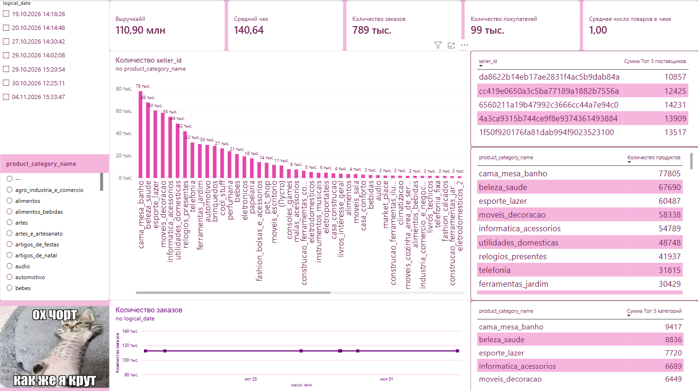
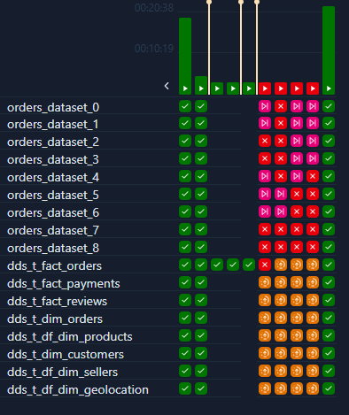
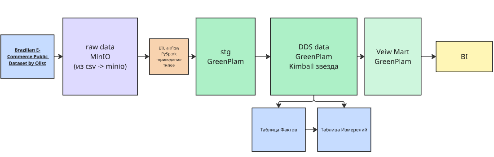

# разработать DWH с бачевой обработкой для ритейл домена с технологиями Greenplum, Airflow, spark


результат моей работы 



рефакторинг дага )  



**Архитектура**  


Данные взяты с [Kaggle Brazilian E-Commerce Public Dataset by Olist](https://www.kaggle.com/datasets/olistbr/brazilian-ecommerce/data?select=olist_orders_dataset.csv)


## to  start 

```bash
docker-compose up -d
```

connect user with minIo and get ACCESS_KEY and SECRET_ACCESS_KEY
```bash
mc.exe alias set <alias_name> https://localhost:9000 <ENV_ACCESS_KEY_ID> <ENV_SECRET_ACCESS_KEY>

mc.exe admin accesskey create <alias_name>
```

